# Order Stream

**A bounded, fault-tolerant JSON order stream processor for the JVM.**

Java 21 · Maven · Jackson · `ServiceLoader` SPI

Order Stream is a command-line tool and embeddable library that turns a noisy, newline-delimited JSON order feed into a deterministic delivery-level summary. It reads within an explicit order and time budget, skips keep-alive lines and malformed records, groups relevant orders by delivery, and writes a single JSON array to an output stream.

Order feeds are rarely clean. They mix order states, contain blank keep-alive lines, occasionally emit malformed records, and may never end. Naive processors either stop at the first bad line or buffer an unbounded stream without a clear stopping rule. Order Stream makes those ingestion limits and aggregation rules explicit, isolates failures per line, and produces stable, explicitly sorted output.

The codebase is deliberately compact — one processing pipeline, a narrow API, and a fixture-driven test suite — which keeps the design decisions easy to inspect.

## At a Glance

| Attribute | Detail |
|:--|:--|
| **Interface** | CLI over stdin/stdout; embeddable Java API over `InputStream` / `OutputStream` |
| **Processing model** | Incremental line-by-line ingestion, then in-memory grouping, sorting and aggregation |
| **Extension point** | `ServiceLoader` SPI, registered at compile time with `@AutoService` |
| **Data handling** | Jackson-bound records, custom enum creators, ISO-8601 timestamps |
| **Testing** | JUnit 5 unit and fixture tests (`JSONAssert`, strict mode) plus packaged-CLI integration tests run by Failsafe |
| **External services** | None; all libraries are bundled in the fat JAR |

## Key Features

- **Two independent ingestion budgets.** Reading stops at whichever comes first: a maximum number of non-blank lines, an elapsed time budget, or end of input.
- **Status-aware filtering.** Only `delivered` and `cancelled` orders are retained. `created` orders and unknown statuses never reach the aggregation stage.
- **Delivery-level aggregation.** Orders are grouped by `delivery_id`; each delivery receives a derived status and a total of its delivered amounts.
- **Deterministic ordering.** Deliveries are sorted by delivery time ascending, then delivery ID ascending. Orders within a delivery are sorted by order ID descending. The same input sequence always produces the same output ordering, independent of hash-map iteration order.
- **Fault isolation per line.** Blank keep-alive lines are ignored, and malformed or incomplete records are logged and skipped without terminating the stream.
- **Pluggable processor implementation.** The CLI depends only on public interfaces and discovers the implementation at runtime, so a different processor can be supplied without changing the entry point.
- **Typed wire models.** Input and output shapes are represented as records with explicit JSON property names and enum mappings.
- **Predictable empty result.** Empty input, exhausted budgets, or a stream with no relevant orders all produce `[]`, never `null`.

## Tech Stack

| Layer | Technology | Role |
|:--|:--|:--|
| Language | **Java 21** | Records, sequenced collections (`List.getFirst()`), modern JDK APIs |
| Build | **Maven** | Dependency management with Jackson and JUnit BOMs, compiler configured for release 21 |
| JSON | **Jackson** (`jackson-core`, `jackson-databind`) | JSON binding and serialization, record support, custom enum (de)serialization |
| Logging | **SLF4J** + **Logback** | Processing logs written to stderr |
| Modularity | **`java.util.ServiceLoader`** + **Google AutoService** | Runtime discovery of the processor factory |
| Testing | **JUnit 5** (Jupiter, parameterized tests) + **JSONAssert** + **Failsafe** | Fixture-driven contract tests with strict JSON comparison; integration tests against the packaged JAR |
| Packaging | **Maven Assembly Plugin** | Self-contained executable JAR with dependencies |

No databases, message brokers, web frameworks, or external services are involved. The runtime surface is stdin/stdout (or caller-supplied streams) only. Because the tool runs entirely over local streams, it has no authentication, authorization, persistence, or network layer; input validation is limited to JSON binding, required-field checks and enum parsing.

## Architecture

The project separates the public contract from the implementation. The `api` package contains only interfaces and the CLI entry point; `impl` contains the processing pipeline and models. The two are connected at runtime through `ServiceLoader`, not through a compile-time reference.

```mermaid
flowchart LR
    subgraph input["Input"]
        STDIN["stdin / InputStream<br/>newline-delimited JSON"]
    end

    subgraph api["Public API — api"]
        APP["StdioStreamApplication<br/>CLI entry point"]
        FACTORY["OrderStreamProcessorFactory"]
        PROCESSOR["OrderStreamProcessor"]
    end

    subgraph impl["Implementation — impl"]
        IMPL["OrderStreamProcessorImpl"]
        READ["readOrders()<br/>parse · filter · group"]
        BUILD["createOutputDeliveries()<br/>sort · aggregate"]
        MAPPER["ObjectMapperFactory<br/>Jackson configuration"]
        MODELS["Input / output records<br/>and enums"]
    end

    subgraph output["Output"]
        STDOUT["stdout / OutputStream<br/>JSON array"]
    end

    STDIN --> APP
    APP -->|"ServiceLoader.load"| FACTORY
    FACTORY -->|"createProcessor(maxOrders, maxTime)"| PROCESSOR
    PROCESSOR -.->|"implemented by"| IMPL
    IMPL --> READ --> BUILD --> MAPPER
    MAPPER --> STDOUT
    MODELS -.-> READ
    MODELS -.-> BUILD
```



### Component Responsibilities

| Component | Responsibility |
|:--|:--|
| [`StdioStreamApplication`](src/main/java/com/brunovidotto/orderstream/api/StdioStreamApplication.java) | Parses CLI arguments (reporting invalid ones with a short message), loads the first service provider, and pipes `System.in` to `System.out`. |
| [`OrderStreamProcessor`](src/main/java/com/brunovidotto/orderstream/api/OrderStreamProcessor.java) | Core contract: process a source stream into a sink stream, with a documented non-closing intent for both. |
| [`OrderStreamProcessorFactory`](src/main/java/com/brunovidotto/orderstream/api/OrderStreamProcessorFactory.java) | Creates a processor with an order limit and a time limit. |
| [`OrderStreamProcessorImpl`](src/main/java/com/brunovidotto/orderstream/impl/OrderStreamProcessorImpl.java) | The complete read → filter → group → sort → aggregate → serialize pipeline. |
| [`OrderStreamProcessorFactoryImpl`](src/main/java/com/brunovidotto/orderstream/impl/OrderStreamProcessorFactoryImpl.java) | Service provider registered via `@AutoService(OrderStreamProcessorFactory.class)`. |
| [`ObjectMapperFactory`](src/main/java/com/brunovidotto/orderstream/impl/ObjectMapperFactory.java) | Central Jackson configuration; rejects trailing tokens and floating-point amounts, and disables automatic target closing so the sink remains caller-owned. |
| [`BoundedLineReader`](src/main/java/com/brunovidotto/orderstream/impl/BoundedLineReader.java) | Reads LF, CRLF and CR terminated lines without closing the source; lines over 1,048,576 characters are reported as too long. |
| [`impl/model/input`](src/main/java/com/brunovidotto/orderstream/impl/model/input) | Immutable input records (`Order`, `Delivery`) and the `OrderStatus` enum with custom Jackson creators. |
| [`impl/model/output`](src/main/java/com/brunovidotto/orderstream/impl/model/output) | Output records (`OutputDelivery`, `OutputOrder`), the `DeliveryStatus` enum, and a builder for deliveries. |
| [`InvalidOrderStatusException`](src/main/java/com/brunovidotto/orderstream/exception/InvalidOrderStatusException.java) | Domain exception for unrecognized status values; Jackson wraps it as a mapping failure. |

### Processing Pipeline

1. **Bounded read.** A `BoundedLineReader` reads one line at a time until the line budget, the time budget, or EOF is reached. Blank lines are skipped before the counter advances; non-blank lines always count, whether or not they later parse.
2. **Parse and filter.** Each line is bound to an `Order` through Jackson. Parse and validation failures are caught per line and logged. Successfully parsed orders are kept only if their status is `DELIVERED` or `CANCELED`; retained orders are grouped by `delivery_id` in a `HashMap`.
3. **Transform and aggregate.** Each group becomes an `OutputDelivery`. Orders are sorted by ID descending, the delivery status is derived from its orders, and delivered amounts are summed with null amounts ignored.
4. **Serialize.** The delivery list is sorted globally by delivery time and ID, then written as one JSON array through the configured `ObjectMapper`.

All per-run state is local to `process()`. A processor instance holds only its configuration and a Jackson mapper; no state leaks between invocations.

### Input Contract

Each non-blank line is one complete JSON object; trailing content after the object rejects the line. Lines may end with LF, CRLF or CR.

```json
{"order_id":"1234567890","order_status":"delivered","delivery":{"delivery_id":"d923jd29j91d1gh6","delivery_time":"2022-05-20T11:50:48Z"},"amount":6477}
```

| Field | Type | Description |
|:--|:--|:--|
| `order_id` | String, required, nonblank | Order identifier, expected to be unique. Ordering uses lexicographic string comparison, not numeric comparison. |
| `order_status` | String, required, nonblank | `created`, `delivered`, or `cancelled` (case-insensitive on input). |
| `delivery.delivery_id` | String, required, nonblank | Groups orders into a delivery. |
| `delivery.delivery_time` | ISO-8601 instant, required | Bound to `java.time.Instant`; used for sorting and serialized back as an ISO-8601 string. |
| `amount` | Integer or `null` | Amount in cents. Must be a JSON integer token within 32-bit int range; floating-point tokens such as `12.5` or `12.0` are rejected. May be absent or `null`. |

Handling rules:

- Whitespace-only lines, of any length, are treated as keep-alives and skipped without consuming the order budget.
- A non-blank line that is not valid JSON, misses a required field, has an invalid amount or an unknown status, or is longer than 1,048,576 characters is skipped and counts as one record toward `maxOrders`.
- Rejections are logged to stderr at `WARN` with the record number and a fixed reason (`malformed JSON`, `invalid order data`, `missing required field` or `record too long`); raw records and exception messages are never logged. The record number counts non-blank records only, so it may differ from the physical line number.
- When reading ends, one `INFO` line reports the record count and why it stopped: `end of input`, `max orders reached` or `time budget elapsed`.
- `created` orders parse successfully but are filtered out after parsing.
- Negative `maxOrders` or `maxTime` is rejected. `maxOrders = 0` or `maxTime = PT0S` produces `[]` without reading any input.
- The processor never closes the source or the sink; I/O errors propagate to the caller. The source's read position afterwards is unspecified, because input is read ahead in buffers.

### Output Contract

```json
[
  {
    "delivery_id": "d923jd29j91d1gh6",
    "delivery_time": "2022-05-20T11:50:48Z",
    "delivery_status": "delivered",
    "orders": [
      { "order_id": "1234567891", "amount": 249 },
      { "order_id": "1234567890", "amount": 6477 }
    ],
    "total_amount": 6726
  }
]
```

| Rule | Behavior |
|:--|:--|
| Delivery ordering | `delivery_time` ascending, then `delivery_id` ascending |
| Order ordering | `order_id` descending, lexicographic |
| `delivery_status` | `delivered` if at least one contained order is delivered; otherwise `cancelled` |
| `total_amount` | 64-bit sum of non-null amounts of **delivered** orders only; `0` if delivered orders exist but all amounts are null, and `null` when no order was delivered |
| `orders` | All retained orders in the delivery, delivered and cancelled alike |
| Empty result | `[]` |

`OutputDelivery.totalAmount()` and `OutputDelivery.Builder.totalAmount(...)` changed from `Integer` to `Long` for direct users of the impl DTO; the JSON shape is unchanged.

This means cancelled order amounts never inflate `total_amount`, and a delivery with one delivered order plus several cancelled orders is still reported as `delivered`.

## Engineering Highlights

### A narrow public API with runtime SPI discovery

**Challenge:** keep the CLI independent of the processing implementation so the pipeline can be replaced without editing the entry point.

**Approach:** `api` exposes only `OrderStreamProcessor` and `OrderStreamProcessorFactory`. The implementation is annotated with `@AutoService`, which generates the `META-INF/services` descriptor during compilation; `StdioStreamApplication` resolves it with `ServiceLoader`.

**Payoff:** the dependency direction is clean (implementation → API, never the reverse), and alternative processors can be dropped onto the classpath. The test suite also asserts that exactly one provider is registered, catching accidental duplicate implementations early.

### Two budgets that model ingested work, not retained output

**Challenge:** a live stream may be effectively unbounded, while downstream consumers still need a bounded run.

**Approach:** the read loop stops at `maxOrders` non-blank lines, an elapsed `maxTime`, or EOF, whichever happens first. Filtered and malformed lines count toward the line budget, so the limit bounds work performed rather than the size of the result.

**Payoff:** a run has a predictable upper bound on parsing effort even when most input is irrelevant. Ignored lines are not retained, so memory follows the number of relevant orders rather than the raw stream length.

### Line-level fault isolation

**Challenge:** one malformed record should not discard an otherwise usable batch.

**Approach:** parsing is wrapped per line. Jackson failures and missing required fields are caught, logged with a fixed reason, and skipped; the loop continues. Unknown statuses surface through `InvalidOrderStatusException`, which Jackson wraps as a mapping failure and the same isolation path handles. A stream with zero relevant records still writes a valid `[]` document.

**Payoff:** partial degradation instead of all-or-nothing processing, with the failing record's ordinal visible in the logs for diagnosis.

### Deterministic aggregation after unordered grouping

**Challenge:** hash-map grouping has no stable iteration order, but consumers need stable, comparable output.

**Approach:** orders are grouped in a `HashMap`, then sorted explicitly at two levels: deliveries by parsed `Instant` plus ID, and orders by ID descending. Delivery status and totals are derived in the same pass over each group.

**Payoff:** output ordering is reproducible for a given input and does not depend on map iteration order — a property the fixture tests enforce with order-sensitive array comparison.

### Wire-model fidelity with records and standard time types

**Challenge:** the input timestamp must be sortable and carried through the pipeline without lossy string handling.

**Approach:** `Delivery` binds `delivery_time` directly to an `Instant`, and `OutputDelivery` exposes that same `Instant` for serialization. `ObjectMapperFactory` registers `JavaTimeModule` and disables timestamp output, so instants are written as ISO-8601 strings. Enums use `@JsonCreator` / `@JsonValue` so wire names such as `cancelled` map cleanly to Java values such as `CANCELED`, with case-insensitive input matching.

**Payoff:** sorting operates on real instants, and timestamps are never parsed or formatted by hand between input and output; JSON concerns stay in the model layer rather than leaking into processing logic.

### Contract tests built around realistic fixtures

**Challenge:** aggregation logic has many interacting edge cases — statuses, nulls, ordering, budgets, and malformed input.

**Approach:** a parameterized JUnit 5 test runs eleven input/output fixture pairs through the real factory and processor, comparing the serialized result with `JSONAssert` in `STRICT` mode. A separate test verifies the `ServiceLoader` invariant.

**Payoff:** tests exercise the public API and actual Jackson serialization rather than isolated helpers, and strict comparison catches unexpected fields or ordering regressions.

## Getting Started

### Prerequisites

- **JDK 21** or newer (the compiler is configured with `--release 21`)
- **Maven 3.8** or newer

No environment variables, databases, message brokers, or external services are required. The repository does not include a Docker setup.

### Build and Test

```bash
git clone https://github.com/BrunoVidotto7/order-stream.git
cd order-stream
mvn clean verify
```

The build runs the full test suite and produces a self-contained executable JAR:

```text
target/order-stream-1.0.0-jar-with-dependencies.jar
```

The plain library artifact is also produced as `target/order-stream-1.0.0.jar`.

### Run the CLI

```bash
java -jar target/order-stream-1.0.0-jar-with-dependencies.jar <maxOrders> <maxTime>
```

| Argument | Format | Meaning |
|:--|:--|:--|
| `maxOrders` | Non-negative integer | Maximum number of non-blank input lines to consume |
| `maxTime` | Non-negative ISO-8601 duration | Maximum time spent in the read loop, e.g. `PT30S`, `PT2M`, `PT0.5S` |

Example:

```bash
java -jar target/order-stream-1.0.0-jar-with-dependencies.jar 100 PT30S \
  < src/test/resources/com/brunovidotto/orderstream/impl/happy-path-input.json-stream
```

With that three-line fixture, the processor emits the following JSON (reformatted here for readability):

```json
[
  {
    "delivery_id": "j93jf923jf23jg9f",
    "delivery_time": "2022-03-20T08:15:00Z",
    "delivery_status": "delivered",
    "orders": [{ "order_id": "1234567892", "amount": 4295 }],
    "total_amount": 4295
  },
  {
    "delivery_id": "d923jd29j91d1gh6",
    "delivery_time": "2022-05-20T11:50:48Z",
    "delivery_status": "delivered",
    "orders": [
      { "order_id": "1234567891", "amount": 249 },
      { "order_id": "1234567890", "amount": 6477 }
    ],
    "total_amount": 6726
  }
]
```

Diagnostic logs go to stderr, so stdout carries only the JSON document. Invalid arguments print a one-line error and the usage to stderr and exit with status 1. The CLI also exits with status 1 and prints "Failed to write output." to stderr if stdout cannot be written.

### Embed the API

```java
OrderStreamProcessorFactory factory = new OrderStreamProcessorFactoryImpl();
OrderStreamProcessor processor = factory.createProcessor(1_000, Duration.ofSeconds(30));

try (InputStream source = Files.newInputStream(Path.of("orders.json-stream"));
     OutputStream sink = Files.newOutputStream(Path.of("deliveries.json"))) {
    processor.process(source, sink);
}
```

The same pipeline can be obtained through `ServiceLoader` when the implementation should not be referenced directly:

```java
OrderStreamProcessorFactory factory = ServiceLoader
    .load(OrderStreamProcessorFactory.class)
    .findFirst()
    .orElseThrow();
```

The processor writes directly to the supplied sink; it does not require a file path, a temporary file, or a web server.

## Testing and Code Quality

Run the suite with:

```bash
mvn test
```

Or run tests and package the application in one step:

```bash
mvn clean verify
```

`mvn clean verify` runs unit tests and fixture tests with Surefire, then packages the JAR and runs integration tests (`*IT`) against it with Failsafe. The packaged-CLI tests launch `java -jar` and check exit codes and stdout/stderr separately. The tests cover:

- the happy path and multi-delivery ordering;
- `maxOrders` truncation and zero-valued order/time budgets;
- mixed delivered/cancelled orders within one delivery;
- `null` amounts and sum semantics;
- blank keep-alive lines, malformed JSON, and unknown statuses;
- empty results;
- required-field validation, line-length and line-terminator handling, and non-closing streams;
- exactly one registered `OrderStreamProcessorFactory`;
- the packaged CLI: clean JSON on stdout, logs on stderr without raw record content, and short errors for invalid arguments.

Fixtures live under [`src/test/resources`](src/test/resources/com/brunovidotto/orderstream/impl), and the fixture test class is [`OrderStreamProcessorFactoryImplTest`](src/test/java/com/brunovidotto/orderstream/impl/OrderStreamProcessorFactoryImplTest.java). `JSONAssert` runs in `STRICT` mode, so the expected output must match completely, including array order; object member order is not significant.

Additional quality practices visible in the codebase:

- Jackson and JUnit versions are controlled through BOM imports rather than repeated version declarations.
- Public interfaces and the main packages carry Javadoc and `package-info.java` descriptions.
- Processing classes are `final`, wire models use records, and snake_case JSON names are declared with Jackson annotations where needed.
- The processor keeps no mutable per-run state on the instance.

**Not present in the repository:** a CI workflow, a linter or static-analysis plugin, and a coverage threshold. `mvn clean verify` is currently the only automated gate.

## Project Structure

```text
order-stream/
├── pom.xml
└── src/
    ├── main/java/com/brunovidotto/orderstream/
    │   ├── api/                 Public contracts and CLI entry point
    │   ├── exception/           Domain exception types
    │   └── impl/
    │       ├── model/
    │       │   ├── input/       Order, Delivery, OrderStatus
    │       │   └── output/      OutputDelivery, OutputOrder, DeliveryStatus
    │       ├── BoundedLineReader.java
    │       ├── ObjectMapperFactory.java
    │       ├── OrderStreamProcessorFactoryImpl.java
    │       └── OrderStreamProcessorImpl.java
    ├── main/resources/          logback.xml (logs to stderr)
    └── test/
        ├── java/.../api/        Packaged-CLI integration tests (*IT)
        ├── java/.../impl/       Unit and parameterized contract tests
        └── resources/.../impl/  JSON input/expected-output fixtures
```

Useful entry points for review:

- [`OrderStreamProcessorImpl.readOrders`](src/main/java/com/brunovidotto/orderstream/impl/OrderStreamProcessorImpl.java) — the bounded read loop and per-line error handling.
- [`OrderStreamProcessorImpl.createOutputDeliveries`](src/main/java/com/brunovidotto/orderstream/impl/OrderStreamProcessorImpl.java) — grouping, sorting and aggregation.
- [`Delivery`](src/main/java/com/brunovidotto/orderstream/impl/model/input/Delivery.java) — the `Instant`-typed timestamp model.
- [`OrderStatus`](src/main/java/com/brunovidotto/orderstream/impl/model/input/OrderStatus.java) — custom JSON enum mapping and domain validation.

## Technical Decisions and Trade-offs

### Buffer retained orders for a deterministic global sort

A true single-pass, constant-memory pipeline cannot emit a globally sorted result without knowing all deliveries in advance. The processor therefore reads incrementally but keeps relevant orders in memory, then sorts and aggregates at the end. Memory grows with the number of retained orders, while ignored lines are discarded immediately. For a bounded CLI run this is a deliberate trade-off: deterministic output over minimal memory.

### Budgets bound work, not output size

`maxOrders` counts input lines rather than retained orders. This makes resource usage predictable even when the feed contains many `created` or malformed records, but it also means the output can be much smaller than the budget. A separate "max retained orders" limit would be a different policy; the current contract is deliberately about ingestion work.

### Time is a soft budget

The deadline uses a monotonic clock and is checked before each record and before each underlying read. A blocked read is not interrupted, so no hard deadline is promised; an interruptible source would be needed for that.

### SPI discovery favors simplicity

`ServiceLoader` keeps the CLI implementation-agnostic with no framework or container. The CLI takes the first provider, so multiple implementations would make selection arbitrary; the test that asserts exactly one provider protects that assumption. A named-provider selection mechanism would be the next step if multiple implementations were expected.

## Known Limitations

- **Time is not a hard deadline.** A read that blocks on a stalled producer is not interrupted, so the run can exceed `maxTime`.
- **`logback.xml` is bundled in the library jar.** Embedders using Logback get its stderr configuration unless they provide their own `logback.xml` or `logback-test.xml`.
- **No CI pipeline.** Only `mvn clean verify` runs the tests.

These are known boundaries of the current implementation, not claims about planned features.
